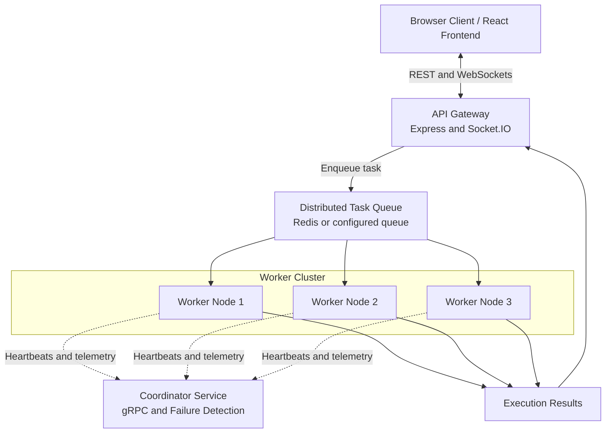

# CloudJudge: Scalable Distributed Code Execution & Evaluation Platform

**A Cloud-Native Distributed Systems Mini Project**  
*Final-Year B.Tech Computer Engineering*

CloudJudge is a distributed code execution and evaluation platform inspired by online coding platforms such as LeetCode and HackerRank. It allows users to submit Python and JavaScript programs, execute them against test cases, and view the results through a web interface.

The project demonstrates key distributed systems concepts, including asynchronous message communication, Lamport logical clocks, worker coordination, failure detection, containerization, and orchestration. It uses a modular architecture in which the API Gateway handles submissions, a message queue distributes tasks, worker nodes execute code, and a Coordinator Service monitors worker health.

The project is designed to run locally, through Docker Compose, or on a Kubernetes cluster, depending on the available configuration.

## 1. Key Features

- **Distributed Architecture:** Separates the frontend, API Gateway, Coordinator Service, and execution workers.
- **Message-Oriented Communication:** Uses an asynchronous queue to distribute tasks among workers.
- **Lamport Logical Clocks:** Assigns logical timestamps to events to help track their ordering.
- **Worker Health Monitoring:** Uses periodic heartbeat messages and timeout-based failure detection.
- **Code Evaluation:** Executes supported Python and JavaScript submissions against test cases.
- **Real-Time Updates:** Uses WebSockets to communicate submission status and execution results.
- **Containerization:** Supports Docker and Docker Compose.
- **Kubernetes Deployment:** Includes manifests for service deployment and worker autoscaling.
- **Load Testing:** Includes a script for generating concurrent requests, if configured.

## 2. Distributed Systems Concepts

| Unit | Concept | Application |
|---|---|---|
| Unit I | Distributed Computing | Independent services work together as one platform. |
| Unit I | Virtualization and Sandboxing | Isolated environments are used for code execution. |
| Unit II | Remote Procedure Call | gRPC and Protocol Buffers support worker-to-coordinator communication. |
| Unit II | Message-Oriented Communication | A task queue separates submission from execution. |
| Unit II | Stream-Oriented Communication | WebSockets deliver real-time updates to clients. |
| Unit II | Fault Tolerance | Failed tasks can be retried when supported by the queue and worker implementation. |
| Unit III | Lamport Logical Clocks | Logical timestamps help track event ordering across processes. |
| Unit III | Failure Detection | Heartbeats and timeouts help identify unresponsive workers. |
| Unit III | Resource Coordination | Execution slots manage access to worker resources. |
| Unit IV | Serverless-Style Execution | Stateless workers handle individual execution tasks. |
| Unit IV | Containerization and Orchestration | Docker Compose and Kubernetes support deployment and scaling. |

## 3. System Architecture

The platform consists of the following components:

1. **Frontend:** Provides the interface for submitting programs and viewing their results.
2. **API Gateway:** Receives requests, assigns logical timestamps, forwards tasks to the queue, and communicates with the frontend.
3. **Message Queue:** Buffers incoming tasks and makes them available to workers.
4. **Worker Nodes:** Execute submitted programs, evaluate test cases, and return results.
5. **Coordinator Service:** Receives worker heartbeats through gRPC and monitors worker availability.

### Architecture Diagram



## 4. Project Structure

```text
cloudjudge-distributed-system/
├── docker-compose.yml
├── package.json
├── proto/
│   └── judge.proto
├── services/
│   ├── api-gateway/
│   ├── coordinator-service/
│   ├── worker-service/
│   └── frontend/
├── k8s/
│   ├── 00-namespace.yaml
│   ├── 01-redis.yaml
│   ├── 02-coordinator.yaml
│   ├── 03-api-gateway.yaml
│   ├── 04-worker.yaml
│   ├── 05-worker-hpa.yaml
│   ├── 06-frontend.yaml
│   └── 07-ingress.yaml
└── scripts/
    ├── install-all.js
    ├── start-local.js
    ├── load-test.js
    └── create-zip.js
```

The root directory contains the main project configuration. The `services` directory holds the application components, `proto` contains the gRPC service definition, `k8s` contains Kubernetes manifests, and `scripts` contains utilities for installation, startup, load testing, and packaging.

## 5. Prerequisites

Depending on the deployment method, you may need:

- Node.js and npm
- Python and JavaScript runtimes supported by the worker implementation
- Docker and Docker Compose
- Redis, if Redis is used as the message broker
- `kubectl` and a running Kubernetes cluster for Kubernetes deployment
- A metrics server for CPU-based Kubernetes autoscaling

## 6. Running the Project

### Option A: Local Mode

Use this option for development and testing without Docker.

**1. Install dependencies**

Open a terminal in the project root and run:

```bash
npm run install:all
```

**2. Start the application**

```bash
npm start
```

**3. Open the frontend**

Navigate to:

```text
http://localhost:3000
```

This mode requires the root scripts and service configurations to be set up correctly. Any external dependencies, such as Redis, must also be running if required.

### Option B: Docker Compose

**1. Build and start the containers**

```bash
docker compose up --build
```

**2. Access the application**

If the corresponding ports are configured in `docker-compose.yml`, use:

| Component | Address |
|---|---|
| Frontend | `http://localhost:3000` |
| API Gateway | `http://localhost:4000` |
| Coordinator HTTP API | `http://localhost:4001` |
| Coordinator gRPC | `localhost:50051` |
| Redis | `localhost:6379` |

**3. Scale the worker service**

If the Compose service is named `worker` and supports replicas, run:

```bash
docker compose up --scale worker=5 -d
```

Replace `worker` with the actual service name in your Compose configuration.

**4. Stop the containers**

```bash
docker compose down
```

### Option C: Kubernetes

**1. Start a Kubernetes cluster**

Use Minikube, Kind, Docker Desktop Kubernetes, or another supported cluster.

**2. Enable the metrics server if required**

For Minikube:

```bash
minikube addons enable metrics-server
```

**3. Deploy the manifests**

```bash
kubectl apply -f k8s/
```

**4. Check pods and services**

```bash
kubectl get pods -n cloudjudge -o wide
kubectl get svc -n cloudjudge
kubectl get hpa -n cloudjudge
```

**5. Access the frontend**

```bash
kubectl port-forward svc/frontend -n cloudjudge 3000:3000
```

Open `http://localhost:3000` in your browser. This assumes the frontend Service exposes port 3000.

## 7. Demonstration Guide

### 7.1 Lamport Logical Clocks

Submit multiple programs through the frontend and inspect their logical timestamps in the submission history, if this feature is implemented.

Lamport clocks use the following update rule when receiving a timestamped event:

\[
L=\max(L_{\text{local}},L_{\text{received}})+1
\]

The timestamps help represent the causal ordering of distributed events. They do not independently guarantee FIFO task execution.

### 7.2 Message Queue and Scalability

Submit several tasks in quick succession or use the provided load-testing script:

```bash
npm run load-test
```

Observe how tasks enter the queue and are processed by available workers. When requests arrive faster than workers can execute them, the queue can buffer the excess workload.

The queue length and parallel processing behavior depend on the monitoring and queue features implemented in the project.

### 7.3 Fault Tolerance

Stop a worker in a controlled test environment and observe the Coordinator's heartbeat monitoring.

If a worker stops sending heartbeats for longer than the configured timeout, the Coordinator can mark it as unavailable. Recovery of its unfinished tasks requires a queue mechanism that supports appropriate acknowledgment, retry, or lease-expiration behavior.

### 7.4 Kubernetes Autoscaling

Run a workload against the deployed system and monitor the worker autoscaler:

```bash
kubectl get hpa -n cloudjudge --watch
```

The Horizontal Pod Autoscaler adjusts the number of worker replicas according to configured metrics and scaling limits. Actual scaling depends on workload, resource requests, cluster capacity, and metrics availability.

## 8. Packaging the Project

If the ZIP-generation script is configured in `package.json`, create an archive using:

```bash
npm run zip
```

The script is expected to package the project source code, configuration files, deployment manifests, and documentation while excluding unnecessary generated files.

The intended archive name is:

```text
cloudjudge-distributed-system.zip
```

Check the script output to confirm the actual archive location.

## 9. Conclusion

CloudJudge demonstrates the use of distributed systems principles in a code execution and evaluation platform. By separating request handling, task distribution, execution, and health monitoring into independent components, the system provides a practical example of asynchronous communication and distributed workload management.

The project also explores logical clocks, failure detection, containerization, and orchestration. Together, these concepts provide a useful foundation for understanding how distributed applications can be developed, tested, and deployed.

**Note:** Features such as durable message delivery, secure code sandboxing, automatic task recovery, and Kubernetes autoscaling depend on their actual implementation and configuration.
